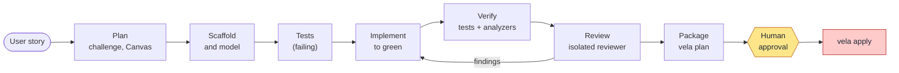

<p align="center">
  
</p>

<h1 align="center">Vela Agentic</h1>

<p align="center">
  <strong>Agent Skills and agents that turn a user story into a tested, reviewed Dataverse plugin,<br/>
  by driving the <a href="https://github.com/allandecastro/vela">Vela</a> CLI. Autonomous up to a human-approved deploy.</strong>
</p>

<p align="center">
  
  <a href="https://github.com/allandecastro/vela-agentic/actions/workflows/ci.yml?query=branch%3Amain"></a>
  <a href="https://www.nuget.org/packages/Vela.Cli"></a>
</p>

<p align="center">
  
  
  
  
</p>

Vela Agentic is the AI layer of [Vela](https://github.com/allandecastro/vela): Agent Skills and two agents that drive
the `vela` CLI to build, test, review and preview Dataverse plugins, and stop before anything is written to an org.

> **Status** - Preview, actively developed alongside Vela. Every merge to `main` publishes a new plugin version;
> the Vela version the pack is verified against is recorded in
> [`references/cli-surface.md`](references/cli-surface.md).

## 📖 Documentation

- **This pack:** [How it works](#how-it-works), [`AGENTS.md`](AGENTS.md) (the rules every agent follows) and the
  [`references/`](references/) the skills read.
- **Vela itself:** the [Vela documentation](https://allandecastro.github.io/vela/) (guides, CLI reference,
  limitations) and [`llms.txt`](https://allandecastro.github.io/vela/llms.txt) for agents.

## Overview

**Vela Agentic** is a pack of 13 [Agent Skills](https://agentskills.io) and two agents for AI coding
assistants (Claude Code and GitHub Copilot, from one source). It teaches the assistant to build Microsoft
Dataverse plugins the way a careful team would:

1. **Plan** the story and pressure-test it, asking the human only what is theirs to decide.
2. **Write failing tests first**, then the code that makes them pass.
3. **Review** the change with an isolated reviewer agent.
4. **Preview** the deployment with a read-only `vela plan`.
5. **Stop** and hand over a Build Report. A human runs the deploy.

Everything goes through the public `vela` CLI. The pack never reaches into Vela's internals and never
writes to an org on its own.

## Contents

- [Quick start](#quick-start)
- [How it works](#how-it-works)
- [Skills](#skills)
- [Safety and guarantees](#safety-and-guarantees)
- [Quality: the skills are tested too](#quality-the-skills-are-tested-too)
- [Repository layout](#repository-layout)
- [Compatibility](#compatibility)
- [Contributing](#contributing)

## Quick start

### Prerequisites

- The `vela` CLI: `dotnet tool install --global Vela.Cli`, and the .NET SDK it requires
  (see [`references/cli-surface.md`](references/cli-surface.md)).
- A Dataverse environment for the steps that read the org (`vela models`, `vela plan`). Sign in
  interactively, or headless with `--url` and an `az login` session, a managed identity, a connection
  string or a client secret.
- A test runner: `dotnet test` on Windows; Mono and the xUnit console runner on macOS and Linux.

### Claude Code

```text
/plugin marketplace add allandecastro/vela-agentic
/plugin install vela
```

### GitHub Copilot CLI

```bash
copilot plugin marketplace add allandecastro/vela-agentic
copilot plugin install vela@vela-agentic
```

Check what loaded with `copilot plugin list`. The optional deploy guard needs a one-time check,
described in [`hooks/README.md`](hooks/README.md).

### Skills only, any host

```bash
gh skill preview allandecastro/vela-agentic   # inspect first
gh skill install allandecastro/vela-agentic
```

### First run

Give `vela-builder` a user story, for example:

> When an account is created, default its description to "New customer".

It plans, scaffolds, tests, implements, reviews and previews, then stops at the deploy gate with a
Build Report and the exact `vela apply` command for you to run.

## How it works



Every step before the gate is local and reversible; the org is only read. Each step needs evidence
(the build summary, the test runner's summary line, the review findings, the plan output) before the
agent may claim it is done.

### Two artifacts per story

Both live in `docs/features/<story>/README.md` in your project and double as the pull request body.

- **Vela Canvas**, written before any code: the structured spec (requirements, entities, approach,
  structure, operations, norms, safeguards), with the design decisions and the acceptance cases. It is a
  living spec: a changed requirement updates the Canvas before the code.
- **Build Report**, written at the gate: what was built, the evidence, and the command to deploy.

### Business rules as the test spec

The agent keeps a rules registry in your project, `docs/rules/<table>.md`. Each rule is written as
Given / When / Then with numbered cases (`ACC-002/C1`), and each test cites the case it proves.

- Rules change only in the design phase, with the human. During the build they are read-only: a
  failing regression test means the code is wrong.
- [`spec-check`](skills/vela-code-review/scripts/spec-check.cs), a script of the review skill, enforces this at review (`dotnet run`): no undeclared
  rule change, no deleted rule, no regression test bent to fit.

A story built end to end, unedited, is in [`examples/`](examples/).

## Skills

| Skill | What it does |
| --- | --- |
| `using-vela` | Entry point: the build loop and the rules every step follows |
| `vela-plan-review` | Pressure-tests the plan and fills the Vela Canvas |
| `vela-grill` | Interviews the human when a story is too ambiguous to build (also `/vela-grill`) |
| `vela-scaffold` | Creates a solution or component with `vela init` and `vela add` |
| `vela-models` | Generates typed models from the org, or checks them for drift |
| `vela-plugin-testing` | Writes the failing tests with `Vela.Testing` and runs them |
| `vela-plugin-authoring` | Implements the plugin until the tests pass |
| `vela-custom-api` | Designs, tests and implements a Custom API |
| `vela-code-review` | Reviews the change against the spec and the standards |
| `vela-apply` | Packages, signs if needed, previews with `vela plan`, stops at the deploy gate |
| `vela-debug-plugin` | Diagnoses a plugin that does not fire or misbehaves |
| `writing-vela-skills` | How to add or fix a skill, test-first |
| `diagnosing-vela` | Turns an agent run into line-level findings against the skills |

The agents:

- **`vela-builder`** drives a story through the whole loop.
- **`vela-reviewer`** is read-only and starts with a fresh context, so it does not share the author's
  blind spots.

## Safety and guarantees

| Guarantee | How |
| --- | --- |
| No deploy without a human | The skills stop before `vela apply`. The optional hook in [`hooks/`](hooks/) blocks `vela apply` unless the session was started with `VELA_APPLY_APPROVED=1`. |
| No untested code | Tests are seen failing before the code, then passing. A happy-path-only suite blocks the gate. |
| No silent spec drift | `spec-check` compares the rules registry and the tests with the base branch. |
| An independent review | `vela-reviewer` reviews every change; any Critical or Required finding blocks the gate. |
| An auditable run | The Build Report carries the run trace: each step, command and exit code, copied from the tool output. |
| No committed secrets | [gitleaks](https://github.com/gitleaks/gitleaks) scans the full history in CI and in the local check. |

## Quality: the skills are tested too

The pack is held under test in [`evals/`](evals/). A fresh agent receives only the story, works
through a scenario, and is graded against hidden criteria:

- **Deterministic checks**: rebuild, rerun the tests, read the registration from the compiled
  assembly, run a read-only `vela plan`.
- **A separate grader** for the rest, including planted violations that the reviewer must catch.

Each deviation is fixed in the skill that allowed it, and the scenario is run again until it passes
cleanly. Every run, failures included, is recorded in [`evals/runs/`](evals/runs/).

## Repository layout

| Path | Contents |
| --- | --- |
| [`skills/`](skills/) | The 13 skills. Each one carries a generated copy of the references it cites. |
| [`agents/`](agents/) | `vela-builder` and `vela-reviewer` |
| [`references/`](references/) | The source of truth for CLI flags, APIs, Dataverse pitfalls and templates |
| [`AGENTS.md`](AGENTS.md) | The rules every agent follows |
| [`hooks/`](hooks/) | Optional guard (`vela apply` without approval, generated files, protected pushes, secrets) and the session version check |
| [`tools/`](tools/) | The fixture tests of `spec-check` |
| [`evals/`](evals/) | Scenarios, checks, grader tools and run records |
| [`examples/`](examples/) | A story built end to end |
| [`scripts/`](scripts/) | Pack lint, Copilot surface generation, local CI |
| `.claude-plugin/` | Plugin and marketplace manifests |
| `.github/` | Copilot surface, generated from the sources above; never edited by hand |

## Compatibility

The skills use the public `vela` command surface and confirm flags with `vela <command> --help` at
run time, so additive CLI changes do not break them. The version the pack is verified against is
recorded in one place, [`references/cli-surface.md`](references/cli-surface.md). A gap in Vela is
reported to Vela, not worked around in the skills. Plans are in [`ROADMAP.md`](ROADMAP.md).

## Contributing

1. Follow [`skills/writing-vela-skills/SKILL.md`](skills/writing-vela-skills/SKILL.md): a change to
   what an agent does ships with the eval that would have caught the problem.
2. Edit the sources (`skills/`, `agents/`, `references/`, `AGENTS.md`), then regenerate with
   `node scripts/sync-copilot.mjs`.
3. Run `sh scripts/check.sh` before pushing: lint, configs, shell syntax, guard tests, secret scan and
   generated files in sync. To run it on every push: `git config core.hooksPath .githooks`.

CI runs the same check, the `spec-check` tests and gitleaks on every pull request.

## Acknowledgments

Built for [Vela](https://github.com/allandecastro/vela). Skill format from the open
[Agent Skills](https://agentskills.io) standard (`SKILL.md`, `AGENTS.md`).

---

<p align="center">
  Crafted with ❤️ and AI by Allan De Castro
</p>

<p align="center">
  License: <a href="LICENSE">MIT</a>
</p>
