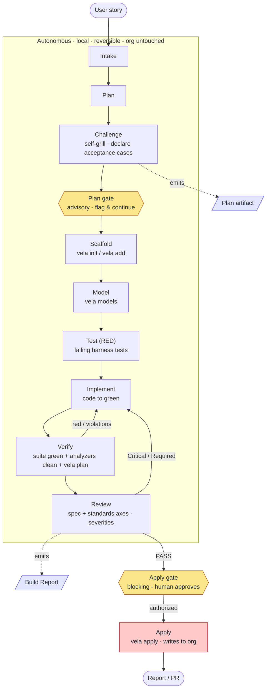

<p align="center">
  
</p>

<h1 align="center">Vela Agentic</h1>

<p align="center">
  <strong>The agentic layer for <a href="https://github.com/allandecastro/vela">Vela</a>: portable Agent Skills and two agents (a builder and a reviewer) that turn a user story into a built, tested, reviewed Dataverse plugin by driving the <code>vela</code> CLI - autonomous up to a human-approved deploy.</strong>
</p>

<p align="center">
  
  
</p>

<p align="center">
  
  
  
  
</p>

`vela-agentic` is a pack of **Agent Skills** and two **agents** (`vela-builder` and
`vela-reviewer`) that let an AI assistant build, model, test, review and deploy Microsoft
Dataverse plugins by driving the `vela` CLI.
It targets **Claude Code** and **GitHub Copilot** from a single source of truth, and it encodes a
safe, **test-first, preview-before-deploy** workflow that stops before writing to a live org.

## Philosophy

- **The CLI is the contract.** Skills wrap the public `vela` command surface (the stable,
  versioned interface) and confirm flags with `--help` at runtime. They do not reach around it.
- **Process, not prose.** Each skill is a workflow with checkpoints, documented rationalizations,
  red flags and a verification section - not reference documentation.
- **Evidence over claims.** No step is "done" without the build/test/plan output that proves it.
- **Test-first quality gate.** Tests are written to fail (RED) before implementation, and the
  deploy gate is unreachable unless the suite is green over every acceptance case and the
  authored code is analyzer-clean.
- **Stop before apply.** The whole loop is autonomous and reversible up to `vela plan`; a human
  approves the `vela apply` that writes to the org.
- **Structured, living spec.** The plan is a **Vela Canvas** (a REASONS-adapted structured spec,
  after Thoughtworks' SPDD), not free text: it captures the design decisions and stays in sync
  with the code (fix the spec first, then the code).
- **Author / reviewer separation.** A second, isolated `vela-reviewer` agent reviews the diff with
  fresh context, catching what the author is blind to - while a human keeps the final say.
- **Loop engineering.** The skills themselves are held under test (`evals/`): a fresh agent runs
  a scenario, deviations become skill fixes, repeat until a clean pass.

## The build loop

`vela-builder` takes a user story and drives it through, with an advisory front gate and a
blocking deploy gate:



It emits two artifacts (Markdown + YAML front-matter), committed under `docs/vela-builds/` in the
target project and reused as the PR body:

- a **Vela Canvas** at the front gate - a REASONS-adapted spec (Requirements, Entities, Approach,
  Structure, Operations, Norms, Safeguards) that captures the design decisions (Sync/Async,
  reuse-vs-new, services, naming, safeguards) and the acceptance cases,
- a **Build Report** at the deploy gate (what was built, evidence, the exact `vela apply` to run),
  which the Canvas grows into. It is a **living spec**: requirement changes update the Canvas first.

## What's inside

| Area | Contents |
| --- | --- |
| `skills/` | 12 portable Agent Skills (`SKILL.md`), read by Claude Code directly |
| `agents/` | `vela-builder` (the gated end-to-end build loop) + `vela-reviewer` (isolated read-only code reviewer) |
| `references/` | Grounded, verbatim knowledge the skills point to (CLI surface, plugin + harness API, Dataverse gotchas, artifact templates). The source of truth: each skill gets a **generated copy** of what it cites under `skills/<name>/references/`, so a skill is self-contained once installed |
| `evals/` | Loop-engineering pressure scenarios + protocol (TDD for the skills) |
| `hooks/` | Optional dual-target guard: a pre-tool hook that hard-blocks `vela apply` without approval (Claude Code + Copilot) |
| `AGENTS.md` | Durable rules every agent follows, plus the build loop and headless/cloud prerequisites |
| `.claude-plugin/` | Claude Code distribution: plugin marketplace + plugin manifest |
| `.github/` | GitHub Copilot distribution (skills, chat mode, instructions) - **generated**, never hand-edited |
| `scripts/` | `sync-copilot.mjs` regenerates `.github/` and the per-skill reference copies; `lint-pack.mjs` checks the pack |

### Skills

| Skill | Kind | What it does |
| --- | --- | --- |
| `using-vela` | model-invoked | Entry point: the build loop and the non-negotiable rules |
| `vela-plan-review` | model-invoked | Self-grill the plan until every branch resolves; emit the Plan artifact |
| `vela-grill` | user-invoked (`/vela-grill`) | Interview the human when a story is too ambiguous to build safely |
| `vela-scaffold` | model-invoked | `vela init` / `vela add` a solution or component (local only) |
| `vela-models` | model-invoked | Generate early-bound C# / TypeScript models, or verify drift |
| `vela-test-harness` | model-invoked | Write failing (RED) tests with `Vela.Testing`, run them per the OS runner |
| `vela-plugin-authoring` | model-invoked | Implement the handler to green (real `EntityPluginBase` / `OnExecute` surface) |
| `vela-code-review` | model-invoked | Review the diff on the spec + standards axes before the apply gate (self-review or isolated subagent) |
| `vela-apply` | model-invoked | Preview with `vela plan`, then stop at the human deploy gate |
| `vela-debug-plugin` | model-invoked | Diagnose a misbehaving plugin (reproduce -> minimize -> hypothesize -> fix) |
| `writing-vela-skills` | model-invoked | The meta-skill: how to add or fix a skill under test (RED -> GREEN -> REFACTOR) |
| `diagnosing-vela` | model-invoked | Turn a run transcript into concrete, line-level skill findings |

> **Status** - Preview, review-first, not yet published. The distribution surfaces (`.claude-plugin/`,
> `.github/`) and the per-skill `skills/<name>/references/` copies are generated from `skills/`, `agents/`,
> `AGENTS.md` and `references/`. Edit the source, then run `node scripts/sync-copilot.mjs`.

## Using it

### With Claude Code

Add this repository as a plugin marketplace, then install the `vela` plugin:

```
/plugin marketplace add allandecastro/vela-agentic
/plugin install vela
```

Then hand `vela-builder` a user story ("When an Account is created, default its Description ...")
and it drives the loop, stopping at the deploy gate for your approval.

### With GitHub Copilot

Copilot CLI reads the same plugin manifest as Claude Code (it supports the `.claude-plugin/`
location), so install this pack as a Copilot **plugin**, mirroring the Claude Code steps:

```bash
copilot plugin marketplace add allandecastro/vela-agentic
copilot plugin install vela@vela-agentic
# or directly, without the marketplace step:
copilot plugin install allandecastro/vela-agentic
```

Verify what loaded with `copilot plugin list`. The **skills** load from `skills/` automatically.
The agents and the optional apply-guard hook follow the Copilot plugin conventions; confirm they
load on your Copilot CLI version and see `hooks/README.md` for the hook caveats.

Portable alternative (skills only, any host, no plugin): install the skills with the official
`gh skill` command (`gh` 2.90.0 or later):

```bash
gh skill preview allandecastro/vela-agentic   # inspect first (skills are not verified by GitHub)
gh skill install allandecastro/vela-agentic
```

Then hand `vela-builder` a user story, the same way as on Claude Code.

### Prerequisites

- The `vela` CLI (`dotnet tool install --global Vela.Cli`) and a matching `dotnet` SDK.
- A Dataverse environment for the `models` / `plan` steps: interactive login locally, or a
  connection string / client secret for headless and cloud runs (see `AGENTS.md`).

## Enforcement & observability

The Build Report carries a machine-readable **Run trace** (step, command, exit code, gate verdict,
timing), so a run is auditable and replayable. On top of that, an **optional** dual-target hook
(`hooks/`, one script wired for Claude Code and GitHub Copilot) makes the deploy gate deterministic:
it **denies `vela apply`** unless a human sets `VELA_APPLY_APPROVED=1`. See `hooks/README.md` for
the per-host wiring and caveats. A CI workflow lints the pack and checks the generated `.github/`
surface stays in sync.

## Loop engineering

The pack is not written once and trusted. Every skill change is validated against an `evals/`
scenario: a fresh agent runs it following the skills to the letter, and each deviation, wrong
command or missing guardrail is a **skill defect** to fix, then a loophole to close. A scenario is
"ready" only when it passes with no blocking finding - not on a hunch. See `evals/README.md`.

## Compatibility

Skills target the public `vela` CLI command surface and discover exact flags at runtime, so
additive CLI changes do not break them. Each skill states a minimum CLI version as a real floor;
breaking CLI changes are matched by a skill update. See [`ROADMAP.md`](ROADMAP.md) for the policy
and what is planned.

## Contributing

New or changed skills follow the house style and the test-first discipline in
`skills/writing-vela-skills/SKILL.md`: no skill change ships without an eval that would have caught
the defect. Never hand-edit `.github/` - it is generated by `scripts/sync-copilot.mjs`.

## Acknowledgments

Built for [Vela](https://github.com/allandecastro/vela). Skill design informed by the Agent Skills
ecosystem (`SKILL.md`, `AGENTS.md`) and the workflow packs that popularized process-first,
verification-driven skills.

---

<p align="center">
  Crafted with care and AI by Allan De Castro
</p>

<p align="center">
  License: <a href="LICENSE">MIT</a>
</p>
