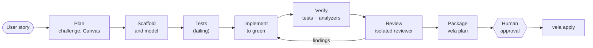

# The build loop

This page describes the loop the pack follows to turn a user story into a previewed plugin: each step, the skill
that runs it, the evidence it must produce, and the two documents that frame the work. It is for developers who
run the agent and for reviewers who read its output.

## The steps

Every step before the gate is local and reversible. The org is only read.

| Step | Skill | What happens | Evidence |
| --- | --- | --- | --- |
| Plan and challenge | [vela-plan-review](skills/vela-plan-review.md), [vela-grill](skills/vela-grill.md) | The story is interpreted, pressure-tested and written as a Vela Canvas with acceptance cases. | The Canvas, committed before any code. |
| Scaffold | [vela-scaffold](skills/vela-scaffold.md) | `vela init` for a new solution, `vela add` for a component. | `dotnet build` output. |
| Model | [vela-models](skills/vela-models.md) | `vela models` generates the typed models the plugin needs. | The "Generated N file(s)" line. |
| Test (RED) | [vela-plugin-testing](skills/vela-plugin-testing.md) | Tests for every acceptance case, seen to fail. | The runner's summary and the failing test names. |
| Implement | [vela-plugin-authoring](skills/vela-plugin-authoring.md) or [vela-custom-api](skills/vela-custom-api.md) | Code until the tests pass. | The runner's summary. |
| Verify | [vela-plugin-testing](skills/vela-plugin-testing.md) | The full suite is green and the authored code has no analyzer (`VELA0xx`) violation. | Runner summary and build summary. |
| Review | [vela-code-review](skills/vela-code-review.md) | The isolated `vela-reviewer` reviews the diff on spec and standards. | The findings list and a PASS verdict. |
| Package and preview | [vela-apply](skills/vela-apply.md) | `dotnet build -c Release`, `vela sign` if the org requires it, then `vela plan --solution <uniquename>` on that package. | The `vela plan` output and exit code. |
| Apply gate | [vela-apply](skills/vela-apply.md) | The agent writes the Build Report and stops. | The Build Report. |

`vela plan` runs last, on the final package. A later code change means testing, review, packaging and preview
again. For what `plan` and `apply` do, see [Plan and apply](../guides/plan-apply.md).

## The gates

- **Plan gate (advisory).** The agent challenges its own plan and records its assumptions, then continues. A
  business decision only the human can make, such as what a story term means or which security roles are
  involved, is asked, not assumed. With no human reachable, the agent stops after the Canvas and hands back the
  questions.
- **Quality gate.** The gate is reachable only when the suite is green and covers every acceptance case, the
  authored code has no analyzer violation, and the review left no unresolved Critical or Required finding.
- **Apply gate (blocking).** The agent stops. A human checks the Build Report and runs `vela apply`.

> [!WARNING]
> An approved review, "ship it" or a merged pull request approves the code, not a write to an org. The agent runs
> `vela apply` only when a human authorizes it for that run.

## Test first

Tests are written from the acceptance cases before the code, and seen to fail. A suite that covers only the happy
path blocks the gate. Each test carries the id of the case it proves. The tests run in memory with `PluginPipeline`;
see [Testing](../guides/testing.md).

## The Vela Canvas

The Canvas is the story's spec, written before any code in `docs/features/<slug>/README.md`. It has YAML front
matter (the table, message, stage, mode, filtering columns, images, the rules the story touches, the acceptance
cases, the decisions and who made them, the assumptions and open questions) and seven short sections:

| Section | Holds |
| --- | --- |
| R - Requirements | The story and the acceptance cases as the definition of done. |
| E - Entities | Tables and columns read and written. |
| A - Approach | Stage, Sync or Async, reuse or new, and why. |
| S - Structure | Project, `vela add plugin` or `vela add step`, services. |
| O - Operations | The registration, the handler outline, the test cases. |
| N - Norms | Naming and code conventions. |
| S - Safeguards | Registration legality, the applicable pitfalls, secrets, stop before apply. |

The Canvas is a living spec: a changed requirement updates the Canvas before the code. A small story (one step on
one table, no outbound call, no open security decision) keeps the front matter and the cases only. The template is
in [`references/build-report-template.md`](https://github.com/allandecastro/vela-agentic/blob/v0.6.0/references/build-report-template.md).

## The rules registry

The project keeps its business rules in `docs/rules/<table>.md`, one file per table. Each rule is written as
Given / When / Then with numbered cases, such as `ACC-002/C1`, and each test cites the case it proves. The registry
is the functional spec of the tests.

- Rules change only in the design phase, with the human. The Canvas lists the rules the story adds, changes or
  retires.
- During the build the registry is read-only, except each rule's trace lines and a change a review finding
  requires, which the Canvas records under `amendments:`.
- A failing regression test means the code is wrong, not the test.

The `spec-check` script of [vela-code-review](skills/vela-code-review.md) enforces this before the review: no
undeclared rule change, no deleted rule, no regression test changed for a rule the story does not touch, no rule id
or ADR number already used on the base branch. See [Project files](project-files.md).

## The Build Report

At the gate the Canvas grows into the Build Report in the same file. It records:

- the versions used, the package path, its SHA-256 and its signing state;
- the evidence: build, RED and GREEN test runs, review verdict and findings, `vela solution show`, `vela plan`
  output and exit code;
- the exact `vela apply` command, what it will change, the rollback and its limits;
- the decisions the human must still take, the assumptions made, and the rule fixes to approve.

The file is the pull request body. The run trace, the reviewer's verbatim output and `plan.json` stay untracked in
`.vela-runs/<slug>/` and are pasted into the pull request.

## Other paths

- **A callable operation** (inputs and outputs, called by code or a flow) follows the same loop with
  [vela-custom-api](skills/vela-custom-api.md).
- **A plugin that misbehaves** goes through [vela-debug-plugin](skills/vela-debug-plugin.md): a failing test that
  reproduces the fault comes before any fix, then the same review and preview.
- **A story that cannot be delivered safely**, such as one that hits a framework limit, ends with the Canvas set to
  `status: blocked` and a hand-off. Nothing is scaffolded. That is a correct outcome.
